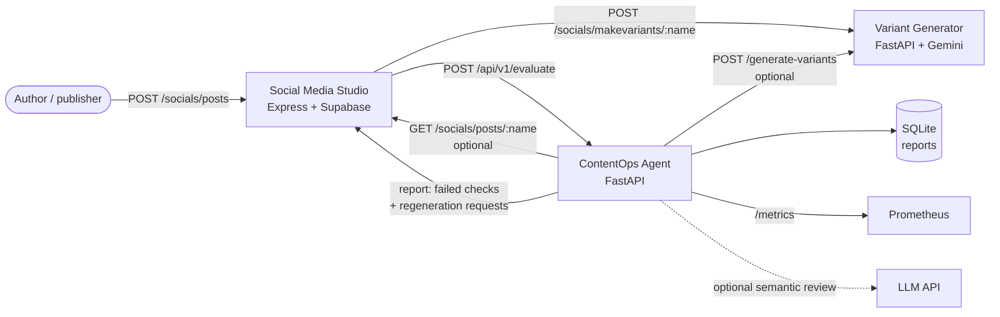

# ContentOps Agent

Small Python service that evaluates AI-generated social media variants before they
are published.

It receives the original article and the platform-specific variations produced for
it, runs deterministic checks (missing fields, character limits, malformed text,
duplicate copy), optionally adds a semantic faithfulness score, and returns a
structured report with the failed checks and regeneration requests.

## Why it exists

The existing content generation services produce text; none of them decide whether
the output is publishable. A variant can be empty, over the platform character
limit, contain a model refusal, be a copy of another platform's post, or drift onto
an unrelated topic. Today a human would have to read every variant to notice.

ContentOps Agent makes that decision explicit, repeatable and observable. It is an
independent service: it does not import or modify the generator code, and it
communicates with the other services over HTTP adapters that can be replaced with
mocks.

## Where it fits



The three services are independent processes. ContentOps Agent works on its own:
both adapters default to mocks, and no published API contract is required for the
core workflow. See [docs/architecture.md](docs/architecture.md) for the verified
contracts and the assumptions that still need checking against the live services.

## What is implemented

- `POST /api/v1/evaluate` — run the checks and store a report.
- Deterministic checks per platform: field presence, length limits, hashtag counts,
  malformed/refusal text, serialised JSON payloads, near-duplicate copy, and
  platform formatting (Discord markdown, Telegram multi-line).
- Semantic consistency: deterministic keyword heuristic by default, optional
  LLM judge that falls back to the heuristic if the API call fails.
- Structured reports persisted in SQLite, with per-check results, scores, a trace
  of the pipeline steps and regeneration requests for failed platforms.
- `POST /api/v1/reports/{id}/regenerate` — ask the generator for new variants for
  the platforms that failed and evaluate the response as a child report.
- Mock and HTTP adapters for Variant Generator and Social Media Studio.
- Prometheus metrics, JSON logs with request ids, liveness/readiness probes.
- Docker image, Compose stack, Kubernetes manifests, CI pipeline, backup and
  restore scripts.

Not implemented (deliberately): scheduling, publishing, approvals, a UI, user
accounts, a queue, or a database beyond SQLite.

## Quick start without Docker

Python 3.11 or newer.

```bash
python3 -m venv .venv
source .venv/bin/activate
pip install -r requirements-dev.txt

uvicorn app.main:app --reload --port 8080
```

Open <http://127.0.0.1:8080/docs> for Swagger UI.

Evaluate a realistic set of variants:

```bash
curl -sS -X POST http://127.0.0.1:8080/api/v1/evaluate \
  -H 'content-type: application/json' \
  -d '{
    "source": {
      "title": "Shipping an observable content pipeline",
      "content": "Generated social posts need deterministic checks, semantic review and metrics so failures stay traceable."
    }
  }' | python -m json.tool
```

Omitting `variants` fetches them from the Variant Generator adapter. With
`VARIANT_GENERATOR_MODE=mock` (the default) that returns deterministic variants
built from the source, so the workflow runs without any external service.

Force a failure to see the report shape:

```bash
MOCK_VARIANT_SCENARIO=missing_field uvicorn app.main:app --port 8080
# then repeat the request above; the instagram variant reports field_present: fail
```

### Docker Compose

```bash
docker compose up -d --build            # app on http://localhost:8080
docker compose --profile monitoring up -d   # adds Prometheus on :9090
docker compose logs -f app
docker compose down
```

The SQLite database lives on the `contentops-data` volume at
`/data/contentops.db`. With the monitoring profile, Prometheus scrapes the app
every 15 seconds using [monitoring/prometheus.yml](monitoring/prometheus.yml).

## API

| Method | Path | Purpose |
| --- | --- | --- |
| GET | `/` | Service name, version, endpoint list |
| GET | `/health` | Liveness; does not touch external services |
| GET | `/ready` | Readiness; 503 when SQLite is unusable, integrations are reported only |
| POST | `/api/v1/evaluate` | Evaluate variants, store and return a report (201) |
| GET | `/api/v1/reports` | List reports; `limit`, `status`, `platform` filters |
| GET | `/api/v1/reports/{id}` | Full report (404 if unknown) |
| POST | `/api/v1/reports/{id}/regenerate` | Regenerate failing platforms (201) |
| GET | `/metrics` | Prometheus exposition |

Request body for `/api/v1/evaluate`:

```json
{
  "source": {"title": "string", "content": "string", "url": "https://optional"},
  "studio_post_name": "alternative to source: fetch the post from the Studio",
  "variants": {
    "x_post": "string",
    "instagram_caption": "string",
    "discord_message": "string",
    "telegram_post": "string"
  },
  "platforms": ["x", "instagram"],
  "parent_report_id": "optional id when re-checking a regeneration"
}
```

`source` and `studio_post_name` are mutually exclusive; `variants` and `platforms`
are optional. Unknown fields and unknown platforms are rejected with HTTP 422.

Responses:

- `201` — report created. `Location` header points at the stored report.
- `404` — the referenced Studio post or report does not exist.
- `409` — regeneration requested but the report has no failed variants.
- `422` — request validation failed.
- `502` — an upstream content service failed; `error.details.attempts` shows how
  many times it was tried.

Every error uses the same envelope, which makes failures easy to log and alert on:

```json
{"error": {"code": "upstream_unavailable", "message": "...", "request_id": "..."}}
```

Report status is `passed`, `warnings` (style-level issues only) or `failed` (at
least one blocking check failed). Variant scores are weighted by check severity.

## Configuration

All settings come from environment variables; `.env` is loaded when present.
Copy [.env.example](.env.example). Nothing has a credential default.

| Variable | Default | Notes |
| --- | --- | --- |
| `DATABASE_PATH` | `data/contentops.db` | Set to `/data/contentops.db` in containers |
| `LOG_LEVEL` / `LOG_FORMAT` | `INFO` / `json` | `console` gives human-readable logs |
| `VARIANT_GENERATOR_MODE` | `mock` | `mock` or `http` |
| `VARIANT_GENERATOR_BASE_URL` | `http://localhost:8000` | Used when mode is `http` |
| `VARIANT_GENERATOR_TIMEOUT_SECONDS` | `5` | Per attempt |
| `VARIANT_GENERATOR_MAX_RETRIES` | `2` | Retries timeouts, connection errors and 5xx/429 |
| `MOCK_VARIANT_SCENARIO` | `clean` | `overflow`, `missing_field`, `duplicate`, `generator_error` |
| `STUDIO_MODE` / `STUDIO_BASE_URL` | `mock` / `http://localhost:3000` | Same pattern |
| `LLM_ENABLED` | `false` | Enabling it without `LLM_API_KEY` stops startup with a clear error |
| `LLM_BASE_URL` | `https://api.openai.com/v1` | Any OpenAI-compatible `/chat/completions` |
| `LLM_MODEL`, `LLM_API_KEY` | `gpt-4o-mini`, unset | No key is stored in the repo |
| `SEMANTIC_THRESHOLD` | `0.35` | Below this the semantic check fails |
| `DUPLICATE_THRESHOLD` | `0.90` | Jaccard similarity that counts as duplicate |
| `METRICS_ENABLED` | `true` | `/metrics` returns 404 when disabled |

## Tests

```bash
pytest                                  # 113 tests
pytest --cov=app --cov-report=term-missing
ruff check . && ruff format --check .
```

Last run in this workspace: `113 passed`, application coverage `95%`, ruff clean.
Unit tests cover the checks, scoring, adapters (including retry, timeout and
malformed responses via `httpx.MockTransport`), the agent and the repository.
Integration tests drive the real FastAPI app through `TestClient` with a temporary
SQLite file per test.

## Kubernetes

```bash
# kind
kind create cluster --name contentops
scripts/k8s-deploy.sh            # builds, loads into kind, applies, waits for rollout
kubectl -n contentops port-forward svc/contentops-agent 8080:80

# Minikube
minikube start --memory=2048
eval $(minikube docker-env)
scripts/k8s-deploy.sh
```

Manifests live in [k8s/](k8s): namespace, ConfigMap, Secret example, PVC,
Deployment (2 replicas, rolling update with `maxUnavailable: 0`, probes, resource
requests/limits, read-only root filesystem, dropped capabilities) and a ClusterIP
Service. There is a small kustomization so `kubectl apply -k k8s` applies
everything in one step. Helm was not used: there is nothing to template beyond one
ConfigMap.

Scale, update and roll back:

```bash
scripts/k8s-scale.sh 3
kubectl -n contentops set image deployment/contentops-agent api=contentops-agent:0.2.0
kubectl -n contentops rollout status deployment/contentops-agent
kubectl -n contentops rollout undo deployment/contentops-agent
scripts/k8s-status.sh
```

## CI/CD

[.github/workflows/ci.yml](.github/workflows/ci.yml) runs on pull requests and on
pushes to `main`:

1. `lint` — `ruff check` and `ruff format --check`.
2. `test` — `pytest` with coverage, failing under 75%.
3. `manifests` — parses every manifest, checks the required kinds are present and
   validates them with `kubeconform`.
4. `docker` — builds the image, starts a container and waits for `/health`.
5. `publish` — on `main` only, pushes `ghcr.io/<owner>/<repo>:<sha>` and `:latest`
   using the workflow's `GITHUB_TOKEN` (`packages: write`). No cloud deploys.

The only credential used is the automatic `GITHUB_TOKEN`; no secret needs to be
created for the pipeline to pass.

## Monitoring

`/metrics` exposes:

- `contentops_http_requests_total{method,path,status}` and a latency histogram
  labelled by route template, so report ids do not create new series.
- `contentops_evaluations_total{status}` and evaluation duration.
- `contentops_variant_results_total{platform,status}` and
  `contentops_failed_checks_total{platform,check,status}`.
- `contentops_integration_requests_total{service,operation,outcome}` and latency
  for calls to the generator, Studio and LLM.
- `contentops_reports_stored`, plus `contentops_app_info`.

Logs are one JSON object per line with `request_id`, route template, status and
duration. The `x-request-id` header is echoed on responses and appears in error
bodies, which makes a failed request traceable through the logs.

## Backup and restore

```bash
scripts/backup.sh                  # backups/contentops-<timestamp>.db
scripts/list-backups.sh
scripts/validate-backup.sh backups/contentops-<timestamp>.db
scripts/restore-backup.sh backups/contentops-<timestamp>.db   # asks first
```

Only the SQLite database is backed up: evaluation reports and the source content
needed to regenerate them. Nothing else has persistent state — logs and metrics are
not backed up, and Prometheus keeps its own retention. The scripts use SQLite's
backup API, so a backup taken while the service is running is consistent. Restore
keeps a `pre-restore-<timestamp>.db` copy, then replaces the database file and both
WAL companions; restoring into a database with a stale write-ahead log silently
loses data, which is why the file is replaced rather than copied over. The full
drill is documented in [docs/operations.md](docs/operations.md#backup-and-restore).

## Troubleshooting

[docs/troubleshooting.md](docs/troubleshooting.md) has nine reproducible scenarios
(container start failure, CrashLoopBackOff, failing readiness, service connectivity,
upstream outage, CI failure, failed rollout, resource limits, data restoration),
each with symptoms, commands, root cause and prevention. Scenarios that were
executed in this workspace are marked as verified; the rest include the exact
commands to run on a machine with Docker or a cluster.

## Project layout

```
app/
  api/            HTTP routes only
  agents/         evaluation orchestration and regeneration
  integrations/   Variant Generator and Studio adapters + retry logic
  services/       checks, semantic scoring, report assembly helpers
  models/         Pydantic contracts, platform rules, SQLite repository
  core/           configuration, logging, metrics, middleware, errors
tests/            unit and integration tests
k8s/              namespace, config, secret example, PVC, deployment, service
monitoring/       Prometheus scrape config
scripts/          operations, backup and restore scripts
docs/             architecture, operations, troubleshooting
backups/          backup output (contents ignored by git)
```

## Limitations

- SQLite on a `ReadWriteOnce` volume means the database is shared by replicas only
  if the storage supports it; two replicas writing to the same file is not the
  intended production setup. Postgres is the obvious next step.
- Reports are cleaned up only by deleting rows; there is no retention job.
- The heuristic semantic score judges topic overlap, not factual accuracy. Use the
  LLM mode for that, and note that LLM mode is not exercised in the test suite
  against a live provider (only against mocked HTTP responses).
- The Variant Generator has no regeneration endpoint. Regeneration reuses
  `/generate-variants` with an instruction prefix, which is the only verifiable
  contract today.
- No authentication. The API assumes it is only reachable by trusted services.
- Rate limiting and request queues are not implemented.
- Settings are read once at startup; changing a ConfigMap requires a rollout.
