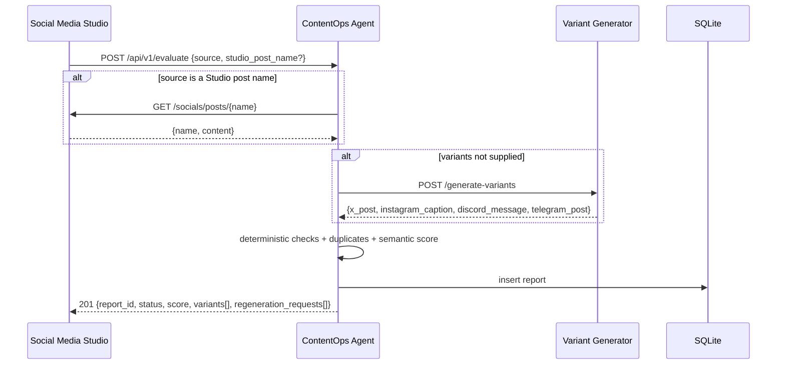
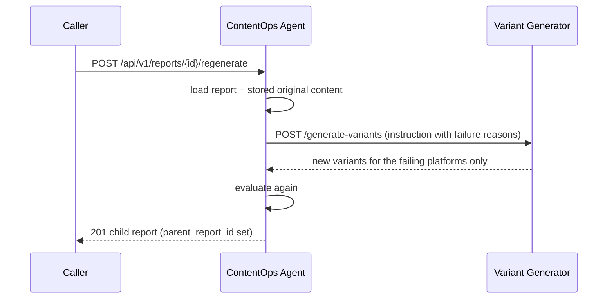

# Architecture

## Responsibilities

ContentOps Agent answers one question: are these generated variants publishable,
and if not, why? It does not generate content, schedule it or publish it.

| Component | Responsibility |
| --- | --- |
| `app/api` | HTTP routes, status codes, request validation, response headers |
| `app/agents/evaluator.py` | Pipeline orchestration: resolve source, obtain variants, evaluate, request regeneration, persist, emit metrics |
| `app/services/validators.py` | Deterministic checks and weighted scoring (pure functions) |
| `app/services/evaluation.py` | Per-variant evaluation combining deterministic, duplicate and semantic checks |
| `app/services/semantic.py` | Keyword heuristic and optional LLM judge, with fallback |
| `app/integrations` | HTTP clients and mocks for the other two services, retries, error mapping |
| `app/models` | Pydantic contracts, platform rules, SQLite repository |
| `app/core` | Settings, logging, metrics, middleware, error envelope |

Routes never contain business logic; the evaluation rules never contain HTTP or SQL.

## Request flow

If the caller needs new copy, either it acts on `regeneration_requests`, or it asks
the agent to do it:

## Checks and severity

| Check | Severity | Fails when |
| --- | --- | --- |
| `field_present` | error | field missing, empty or whitespace |
| `length` | error over the limit, warning under the minimum | outside the platform range |
| `hashtags` | warning | outside the platform's expected range |
| `malformed_content` | error | refusal text, template placeholders, `N/A`, raw JSON payload, short truncation marker |
| `platform_style` | warning | Discord copy has no markdown, Telegram copy is a single line |
| `duplicate_content` | error | Jaccard similarity to another variant ≥ `DUPLICATE_THRESHOLD` |
| `semantic_consistency` | error | score below `SEMANTIC_THRESHOLD` |

Limits are data in `app/models/platforms.py` (X 280, Instagram 2200 with 5–8
hashtags, Discord 2000, Telegram 4096). A variant's status is `failed` when a
blocking (error-severity) check fails, `warnings` when only style checks fail, and
`passed` otherwise. Scores weight error checks 3 and warnings 1; a failed warning
still earns half its weight so a style problem does not zero the score.

## Semantic scoring

The default heuristic compares three signals and reports all three in the check
details, so a score can be argued with:

- `title coverage` — share of the article title's key terms used by the post.
- `containment` — share of the post's key terms present in the source.
- `coverage` — share of the source's vocabulary used, capped at 10 terms because a
  280-character post cannot repeat an article.

`score = 0.4 * title + 0.35 * containment + 0.25 * coverage`. Keyword extraction
lowercases, strips URLs, hashtag markers and stopwords, and requires at least three
characters. It judges topic, not facts.

With `LLM_ENABLED=true` the same call is sent to an OpenAI-compatible
`/chat/completions` endpoint asking for `{score, consistent, issues, summary}`.
Any HTTP error, timeout or unparseable response falls back to the heuristic and the
report records `evaluator.fallback_reason`. An evaluation never fails because the
LLM is unavailable.

## Integration contracts

These were read from the public repositories on 2026-11-20, not assumed.

**Variant Generator** (`jameskipngetich/variant_generator`, `agent2.py`)

- `POST /generate-variants`
- Request: `{"title": str, "content": str, "url": str | "none" | absent}`
- Response: `{"x_post": str, "instagram_caption": str, "discord_message": str,
  "telegram_post": str}` with Gemini structured output enforced upstream.
- Failure: HTTP 500 with `{"detail": ...}`.
- No authentication, no regeneration endpoint, no versioning header.

**Social Media Studio** (`jameskipngetich/s0c14l_m3d14_studio`, `src/routes/router.js`)

- `GET /socials/posts/:name` — post metadata and content; content is written to a
  JSON file and read back, so the adapter also unwraps JSON-looking content.
- `POST /socials/makevariants/:name` — returns the generator response as a **JSON
  string** (`res.json(JSON.stringify(...))` in the controller). The adapter decodes
  the double encoding; anything else would fail on `.json()` shape checks.
- Content is stored as `{name, content}`; the `url` field the generator expects is
  sent as `"none"` when there is no source URL.

Still unverified and marked as such in the code:

- The Studio's `GET /socials/posts/:name` response envelope has not been called
  against a running instance; the adapter accepts `{name, content}`, a list of such
  objects, or a JSON string inside `content`.
- No authentication is implemented for either upstream. If one is added, set the
  header in the adapter and read the value from an environment variable.

`VARIANT_GENERATOR_MODE=http` is therefore usable once the URL is reachable. The
mock remains the default because neither upstream is running in this environment.

## Adapter behaviour

- Configurable base URL and timeout per service.
- Retries for timeouts, connection errors, HTTP 429 and 5xx, with exponential
  backoff (0.2s, 0.4s…), capped by `*_MAX_RETRIES`. 4xx responses are not retried.
- All failures become `IntegrationError` with a `kind` (`timeout`, `connection`,
  `http_error`, `malformed_response`, `not_found`, `disabled`), which the agent maps
  to 404 (missing Studio post) or 502 (everything else) with retry counts in the
  response details.
- Adapters are constructed at startup but do nothing until a request needs them, so
  an unreachable upstream cannot prevent startup or fail `/ready`.

## Persistence

One table, `reports`, with promoted columns for listing (`created_at`, `status`,
`score`, `title`, `platforms`, `failed_checks`, `parent_report_id`) and the full
report as JSON. `source_json` keeps the original content so regeneration works
without asking the caller for it again. WAL mode plus a busy timeout keeps the
read-modify-write pattern from failing under concurrent requests; the repository
opens a short-lived connection per operation, which avoids the threading problems of
sharing a connection across async tasks.

## Decisions worth knowing

- **201 on evaluate.** A report is a resource; the response carries its `Location`.
  Using 200 would hide that a persisted record now exists.
- **Reports are created for failures too.** The report is the record of the failure,
  not an HTTP error. Only upstream and validation problems are non-2xx.
- **Regeneration targets `failed` variants only.** Style warnings do not justify a
  new model call; the report still exposes them.
- **Problems are visible in the response and the log.** Every error has a `code`,
  a `request_id` and, for upstream failures, the retry count.
- **No Helm.** One ConfigMap, one Deployment, one Service; kustomize covers it.
- **No frontend.** Swagger plus this documentation is enough for the current users,
  which are services.

## Extending

- New platform: add a `PlatformRule` in `app/models/platforms.py`; the request
  validation, checks, metrics labels and regeneration loop pick it up.
- New check: add a function returning `CheckResult` in `validators.py` and append it
  in `evaluation.py`; the score reacts to its severity automatically.
- Different store: implement the small surface used by the agent (`initialise`,
  `healthcheck`, `save`, `get`, `get_source`, `list`, `count`).
- Real regeneration endpoint upstream: change only
  `HttpVariantGeneratorAdapter.request_regeneration`.
